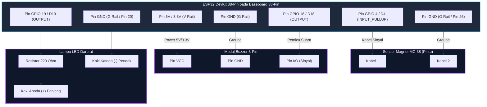

# PANDUAN TUTORIAL LENGKAP: IOT SENSOR PINTU ANTI MALING BERBASIS ESP32
*Sesuai Referensi Demo Kit Tokotronik ([YouTube Video](https://www.youtube.com/watch?v=wkzndpY5nb0))*

---

## DAFTAR ISI
1. [Prinsip Kerja Sistem](#1-prinsip-kerja-sistem)
2. [Alat & Bahan + Koreksi Lengkap Kebutuhan Fisik](#2-alat--bahan--koreksi-lengkap-kebutuhan-fisik)
3. [Skema Kelistrikan & Jalur Wiring (Pinout Mapping)](#3-skema-kelistrikan--jalur-wiring-pinout-mapping)
4. [Persiapan Software & Konfigurasi IoT Cloud](#4-persiapan-software--konfigurasi-iot-cloud)
   - 4.1 Instalasi Driver & Arduino IDE
   - 4.2 Instalasi Board ESP32 & Library Pendukung
   - 4.3 Setup New Blynk IoT (v2.0) di Web & Android
   - 4.4 Setup Opsi Alternatif: Telegram Bot Notifier
5. [Langkah Rinci Step-by-Step Perakitan & Flashing](#5-langkah-rinci-step-by-step-perakitan--flashing)
6. [Source Code / Program Arduino IDE](#6-source-code--program-arduino-ide)
7. [Prosedur Pengujian & Simulasi Demo](#7-prosedur-pengujian--simulasi-demo)
8. [Panduan Pemasangan Fisik pada Kusen & Pintu](#8-panduan-pemasangan-fisik-pada-kusen--pintu)
9. [Troubleshooting & Solusi Masalah Umum](#9-troubleshooting--solusi-masalah-umum)
10. [Pengembangan Mandiri di Editor: Ekstensi Visual, Shortcut & Antigravity](#10-pengembangan-mandiri-di-editor-ekstensi-visual-shortcut--antigravity)

---

## 1. PRINSIP KERJA SISTEM

Sistem alarm anti maling ini memanfaatkan kombinasi **keamanan fisik (alarm lokal)** dan **keamanan digital (notifikasi cloud jarak jauh)**:

```
[ Pintu Tertutup ]  ---> Magnet nempel pada Sensor MC-38  ---> Sirkuit Tertutup (LOW)  ---> ESP32 Senyap & Siaga
                                     | (Pintu dibuka maling)
[ Pintu Terbuka ]   ---> Magnet terpisah dari Sensor MC-38 ---> Sirkuit Terbuka (HIGH) ---> ESP32 Memicu Aksi:
                                                                                           ├─ 1. Buzzer berbunyi sirine darurat
                                                                                           ├─ 2. Lampu LED berkedip cepat
                                                                                           ├─ 3. Kirim sinyal WiFi ke Internet
                                                                                           └─ 4. Push Notification masuk ke HP pemilik
```

1. **Sensor Magnetik (MC-38 Magnetic Reed Switch)** terdiri dari 2 bagian:
   - Bagian **Sensor** (berkabel) berisi saklar tabung gas kaca (*reed switch*) yang sensitif terhadap medan magnet.
   - Bagian **Magnet** (tanpa kabel) berisi magnet permanen neodymium.
2. Ketika pintu tertutup rapat, magnet menarik pelat kontak di dalam sensor sehingga rangkaian terhubung ke **GND** (ESP32 membaca sinyal logika `LOW`).
3. Ketika pintu dibuka oleh pencuri, magnet menjauh (> 1.5 cm), pelat kontak terlepas, dan resistor pull-up internal ESP32 menarik tegangan pin ke 3.3V (ESP32 membaca sinyal logika `HIGH`).
4. Seketika itu juga, ESP32 mengaktifkan modul **Buzzer** dan **LED** secara serempak, sekaligus mengirimkan sinyal ke platform **Blynk IoT** atau **Telegram** untuk memberitahu pemilik rumah dimanapun berada secara *real-time*.

---

## 2. ALAT & BAHAN + KOREKSI LENGKAP KEBUTUHAN FISIK

Berdasarkan foto komponen yang Anda miliki, berikut audit perbandingan antara **barang yang ada di meja** dengan **kebutuhan riil saat dirakit**:

| Komponen | Status di Foto | Fungsi Utama | Koreksi & Catatan Penting |
| :--- | :---: | :--- | :--- |
| **ESP32 DevKit 38-Pin** | ✅ Ada | Otak pengendali utama mikrokontroler (Dual-Core WiFi + Bluetooth). | Varian 38-pin (19 pin kiri, 19 pin kanan). Pastikan semua kaki lurus saat dicolokkan ke baseboard. |
| **Baseboard Breakout ESP32 38-Pin** | ✅ Ada | Papan ekspansi mempermudah jalur VCC, GND, dan GPIO tanpa breadboard. | Memiliki soket **Triple Power** (Jack DC 6.5V-16V, port Micro-USB, port Type-C) & selector jumper tegangan. |
| **Sensor Magnet MC-38** | ✅ Ada | Mendeteksi buka-tutup daun pintu dengan saklar reed magnetik pasif. | Kabel bawaan berujung serabut telanjang (*bare wire*). Panjang/pendek bebas polaritas. |
| **Buzzer Module (3 Pin)** | ✅ Ada | Alarm sirine lokal frekuensi tinggi. | Memiliki 3 pin header: `VCC`, `GND`, `I/O`. Catu daya 3.3V – 5V. |
| **LED 5mm Merah** | ✅ Ada | Indikator visual darurat. | Kaki anoda (+) panjang dan katoda (-) pendek. Wajib resistor 220Ω. |
| **Kabel USB Biru (Micro-USB)** | ✅ Ada | Media upload program dari laptop & power sementara pengujian. | Cocok untuk upload koding dari laptop/PC. |

### ⚠️ Komponen Tambahan Spesifik yang Wajib & Dibutuhkan (Angka Pas & To the Point)

Agar komponen pada foto dapat dirangkai utuh dan siap dipasang di kusen pintu rumah, berikut daftar belanja/tambahan dengan **angka jumlah dan spesifikasi teknis pasti**:

| No | Nama Komponen Tambahan | Jumlah Pas | Spesifikasi Teknis | Fungsi Spesifik |
|:---|:---|:---:|:---|:---|
| 1 | **Resistor Karbon / Metal Film** | **1 buah** | **220 Ω, 1/4 Watt (0.25W)**<br>*(Gelang warna: Merah-Merah-Cokelat-Emas)* | Pembatas arus wajib untuk Anoda (+) LED 5mm agar GPIO ESP32 tidak overcurrent (>20mA) / terbakar. |
| 2 | **Kabel Jumper Female-to-Female (F-F)** | **3 helai** | Panjang **20 cm**, AWG 26 | Menghubungkan 3 pin male Modul Buzzer (`VCC`, `GND`, `I/O`) langsung ke baris pin male Baseboard 38-pin. |
| 3 | **Kabel Jumper Female-to-Male (F-M)** | **4 helai** | Panjang **20 cm**, AWG 26 | • **2 helai**: Menjepit 2 kaki kawat LED ke Baseboard.<br>• **2 helai**: Menjepit 2 serabut kawat sensor magnet ke Baseboard. |
| 4 | **Adaptor Charger HP USB / DC** | **1 unit** | **DC 5 Volt, 1 Ampere - 3 Ampere (5V 1A/2A/3A)** | Catu daya mandiri permanen setelah koding selesai di-upload (3A sangat direkomendasikan mencegah brownout saat WiFi memancar). |
| 5 | **Kabel USB Panjang (Micro-USB / Type-C)** | **1 buah** | Panjang **1.0 meter - 1.5 meter** | Menggantikan kabel USB biru bawaan (±30 cm) yang terlalu pendek dari stopkontak dinding ke atas kusen pintu. |
| 6 | **Double Tape Foam 3M** | **1 roll kecil** | Lebar **12 mm atau 24 mm** (Busa abu/putih kuat) | Merekatkan modul sensor reed pada kusen dan modul magnet pada daun pintu. |
| 7 | **Solasi Listrik Hitam / Selotip** | **1 buah** | Lebar standar (Vinyl electrical tape) | Membungkus lilitan kaki resistor dan kaki LED agar tidak saling senggolan (korsleting). |

> 🛒 *Tips Belanja Praktis di Toko Elektronik/Marketplace*:  
> Cukup beli: **1 bungkus Resistor 220Ω (isi 10 pcs ~Rp1.000)**, **1 set Kabel Jumper F-F (isi 10 ~Rp4.000)**, dan **1 set Kabel Jumper F-M (isi 10 ~Rp4.000)**.

---

### 💡 Analisis Teknis: Apakah Perlu Breadboard? (Lebih Mudah atau Lebih Sulit?)

**Kesimpulan: JAUH LEBIH MUDAH tetap menggunakan Baseboard ESP32 38-Pin yang sudah Anda miliki di foto.**

* **Mengapa Breadboard Biasa Justru LEBIH SULIT untuk ESP32 38-Pin?**
  1. **ESP32 38-Pin Sangat Lebar**: Board ESP32 38-pin memiliki jarak pin yang lebar (19 pin kiri, 19 pin kanan). Jika dicolokkan di tengah breadboard standar (MB-102), seluruh lubang di salah satu sisi akan **tertutup habis total**, menyisakan 0 lubang untuk kabel jumper! Anda terpaksa harus menggabungkan dua breadboard sekaligus.
  2. **Rawan Lepas / False Alarm di Pintu**: Pintu rumah sering mengalami getaran dan hentakan keras saat ditutup. Kontak jepit di breadboard sangat mudah kendor/terlepas, yang akan memicu alarm palsu berbunyi sendiri di tengah malam.
  3. **Baseboard 38-Pin Sudah Sempurna**: Baseboard hitam di foto Anda sengaja diciptakan untuk **menggantikan breadboard sepenuhnya**. Baseboard sudah memecah setiap pin GPIO, VCC 5V/3.3V, dan GND ke deretan pin header siap colok jumper, serta dilengkapi socket DC Jack dan port USB Type-C/Micro-USB langsung di papan.
* **Opsi Breadboard yang Masuk Akal (Opsional)**:
  Hanya jika Anda membeli **Breadboard Mini 170 Titik** (seukuran jempol tangan seharga Rp3.000) yang digunakan **khusus sebagai tempat menancapkan kaki LED dan Resistor 220Ω** agar berdiri tegak rapi. Namun modul ESP32 **wajib tetap tertancap di Baseboard 38-Pin**.

---

## 3. SKEMA KELISTRIKAN & JALUR WIRING BASEBOARD 38-PIN

### A. Tabel Jalur Pengkabelan (Wiring Matrix & Sablon PCB 38-Pin)

> ⚠️ **PENTING TENTANG NAMA PIN PADA BASEBOARD 38-PIN**:  
> Pada fisik Baseboard dan modul ESP32, pin **TIDAK DITULIS** dengan kata *"GPIO 4"*, melainkan disingkat dengan huruf **`D4`** (atau hanya angka **`4`**). Demikian juga GPIO 18 ditulis **`D18`**, dan GPIO 19 ditulis **`D19`**.

| Dari Komponen | Pin / Kaki Komponen | Label Sablon di Baseboard 38-Pin | Nomor di Koding | Posisi Fisik pada Baseboard 38-Pin | Keterangan & Aturan Sambung |
| :--- | :--- | :---: | :---: | :--- | :--- |
| **Sensor Magnet MC-38** | Kabel Putih 1 *(Panjang)* | **`D4`** *(atau `4`)* | `GPIO 4` | Sisi Kanan (Pin 32, antara D16 & D0) | Pin Input Sensor (Mode `INPUT_PULLUP`). |
| | Kabel Putih 2 *(Pendek)* | **`GND`** *(atau `G`)* | `GND` | Sisi Kanan (Pin 20, 26, atau rail G) | **Bebas tertukar 100%!** (Sensor magnet pasif tanpa kutub +/-). |
| **Modul Buzzer (3-Pin)** | Pin `VCC` | **`5V`** *(atau `V`)* | - | Header VCC Power Rail (5V/3.3V) | Daya modul buzzer (3.3V – 5V). |
| | Pin `GND` | **`GND`** *(atau `G`)* | `GND` | Header Ground Rail (G) | Ground modul buzzer. |
| | Pin `I/O` *(Data / SIG)* | **`D18`** *(atau `18`)* | `GPIO 18` | Sisi Kanan (Pin 28, tepat di bawah D19) | Sinyal pemicu alarm (HIGH = Bunyi sirine). |
| **LED Merah 5mm** | Kaki Panjang *(Anoda +)* | **`D19`** *(atau `19`)* | `GPIO 19` | Sisi Kanan (Pin 27, tepat di atas D18) | Wajib seri Resistor 220Ω (HIGH = Lampu berkedip). |
| | Kaki Pendek *(Katoda -)* | **`GND`** *(atau `G`)* | `GND` | Header Ground Rail (G atau Pin 26) | Ground kaki negatif LED. |

---

### B. Anatomi Lengkap Seluruh 38 Pin ESP32 & Baseboard

Modul ESP32 38-Pin memiliki dua deret pin (19 pin di kiri dan 19 pin di kanan). Berikut adalah peta lengkap fungsi seluruh pin:

#### 1. SISI KIRI (Pin 1 s/d 19 - Dari Atas ke Bawah):
| No | Label Sablon | Nama GPIO / Fungsi | Sifat Pin | Rekomendasi Penggunaan |
|:---:|:---|:---|:---|:---|
| 1 | **3V3** | Output 3.3V Regulator | Power Output | Sumber daya sensor bertegangan 3.3V (Maks ~500mA). |
| 2 | **EN** | CHIP_PU (Reset) | Control Pin | Tombol Reset fisik ESP32 (Ditarik LOW untuk reset). |
| 3 | **VP** | GPIO 36 (ADC1_CH0) | **INPUT ONLY** | Khusus input sensor analog. Tidak bisa digital output! |
| 4 | **VN** | GPIO 39 (ADC1_CH3) | **INPUT ONLY** | Khusus input sensor analog. Tidak bisa digital output! |
| 5 | **D34** | GPIO 34 (ADC1_CH6) | **INPUT ONLY** | Khusus input digital/analog. Tidak punya pullup internal! |
| 6 | **D35** | GPIO 35 (ADC1_CH7) | **INPUT ONLY** | Khusus input digital/analog. Tidak punya pullup internal! |
| 7 | **D32** | GPIO 32 (Touch 9) | General I/O | Pin digital serbaguna, ADC1, Touch sensor. |
| 8 | **D33** | GPIO 33 (Touch 8) | General I/O | Pin digital serbaguna, ADC1, Touch sensor. |
| 9 | **D25** | GPIO 25 (DAC 1) | General I/O | Pin digital serbaguna, output audio DAC. |
| 10 | **D26** | GPIO 26 (DAC 2) | General I/O | Pin digital serbaguna, output audio DAC. |
| 11 | **D27** | GPIO 27 (Touch 7) | General I/O | Pin digital serbaguna (Aman untuk sensor). |
| 12 | **D14** | GPIO 14 (Touch 6) | General I/O | **Alternatif Aman Sensor Pintu** jika D4 sulit dicari. |
| 13 | **D12** | GPIO 12 (Touch 5) | Strapping Pin | JANGAN ditarik HIGH saat start (bisa gagal booting). |
| 14 | **GND** | Ground (0 Volt) | Power Ground | Jalur negatif rangkaian. |
| 15 | **D13** | GPIO 13 (Touch 4) | General I/O | **Alternatif Utama Sensor Pintu** (Sangat aman & stabil). |
| 16 | **D9** | GPIO 9 (SD2) | ⛔ **TERLARANG** | Terhubung ke SPI Flash internal ESP32! |
| 17 | **D10** | GPIO 10 (SD3) | ⛔ **TERLARANG** | Terhubung ke SPI Flash internal ESP32! |
| 18 | **D11** | GPIO 11 (CMD) | ⛔ **TERLARANG** | Terhubung ke SPI Flash internal ESP32! |
| 19 | **VIN / 5V**| Input/Output 5V | Power In/Out | Jalur daya 5V dari kabel USB atau DC Jack baseboard. |

#### 2. SISI KANAN (Pin 20 s/d 38 - Dari Atas ke Bawah):
| No | Label Sablon | Nama GPIO / Fungsi | Sifat Pin | Rekomendasi Penggunaan |
|:---:|:---|:---|:---|:---|
| 20 | **GND** | Ground (0 Volt) | Power Ground | Jalur negatif rangkaian (Sisi Kanan Atas). |
| 21 | **D23** | GPIO 23 (VSPI MOSI) | General I/O | Komunikasi SPI atau I/O digital bebas. |
| 22 | **D22** | GPIO 22 (I2C SCL) | General I/O | Clock I2C default untuk layar OLED / LCD. |
| 23 | **TX / TX0** | GPIO 1 (UART0 TX) | Serial Monitor | Transmit data ke komputer. Jangan dipakai untuk sensor! |
| 24 | **RX / RX0** | GPIO 3 (UART0 RX) | Serial Monitor | Receive data dari komputer. Jangan dipakai untuk sensor! |
| 25 | **D21** | GPIO 21 (I2C SDA) | General I/O | Data I2C default untuk modul sensor bus I2C. |
| 26 | **GND** | Ground (0 Volt) | Power Ground | Jalur negatif rangkaian (Sisi Kanan Tengah). |
| 27 | **D19** | GPIO 19 (VSPI MISO)| General I/O | 🔴 **TERHUBUNG KE LED MERAH (+) via RESISTOR 220Ω** |
| 28 | **D18** | GPIO 18 (VSPI CLK) | General I/O | 📢 **TERHUBUNG KE PIN I/O MODUL BUZZER** |
| 29 | **D5** | GPIO 5 (VSPI CS0) | Strapping Pin | Output PWM singkat saat booting awal. |
| 30 | **TX2 / D17**| GPIO 17 (UART2 TX)| General I/O | Pin digital serbaguna / Serial Hardware 2. |
| 31 | **RX2 / D16**| GPIO 16 (UART2 RX)| General I/O | Pin digital serbaguna / Serial Hardware 2. |
| 32 | **D4** | GPIO 4 (Touch 0) | General I/O | 🚪 **TERHUBUNG KE SENSOR MAGNET MC-38 (Kabel 1)** |
| 33 | **D0** | GPIO 0 (BOOT) | Strapping Pin | Tombol BOOT fisik (Ditarik LOW saat flashing koding). |
| 34 | **D2** | GPIO 2 (LED Biru) | Strapping Pin | Terhubung ke lampu LED biru bawaan modul ESP32. |
| 35 | **D15** | GPIO 15 (Touch 3) | Strapping Pin | Mengirim output debug saat boot jika ditarik HIGH. |
| 36 | **D8** | GPIO 8 (SD1) | ⛔ **TERLARANG** | Terhubung ke SPI Flash internal ESP32! |
| 37 | **D7** | GPIO 7 (SD0) | ⛔ **TERLARANG** | Terhubung ke SPI Flash internal ESP32! |
| 38 | **D6** | GPIO 6 (CLK) | ⛔ **TERLARANG** | Terhubung ke SPI Flash internal ESP32! |

---

### C. Diagram Visual Letak Fisik Pin di Baseboard 38-Pin

Posisikan Baseboard menghadap Anda (dengan **Jack DC Hitam / Colokan Adaptor dan Port USB Type-C & Micro-USB berada di sisi Kiri Bawah**, persis seperti foto komponen Anda):

```text
                        [ ANTENA PCB ESP32 (SISI ATAS) ]
        SISI KIRI (19 Pin)                            SISI KANAN (19 Pin)
   [1]  [3V3]  - Tegangan 3.3V                   [20] [GND]  - Ground (0V)
   [2]  [EN]   - Reset Chip                      [21] [D23]  - GPIO 23
   [3]  [VP]   - GPIO 36 (Input-Only)            [22] [D22]  - GPIO 22 (I2C SCL)
   [4]  [VN]   - GPIO 39 (Input-Only)            [23] [TX]   - UART0 TX (Monitor)
   [5]  [D34]  - GPIO 34 (Input-Only)            [24] [RX]   - UART0 RX (Monitor)
   [6]  [D35]  - GPIO 35 (Input-Only)            [25] [D21]  - GPIO 21 (I2C SDA)
   [7]  [D32]  - GPIO 32                         [26] [GND]  - Ground (0V)
   [8]  [D33]  - GPIO 33                         [27] [D19]  - GPIO 19 <=== [LED ANODA (+) + 220Ω]
   [9]  [D25]  - GPIO 25                         [28] [D18]  - GPIO 18 <=== [BUZZER I/O]
  [10]  [D26]  - GPIO 26                         [29] [D5]   - GPIO 5
  [11]  [D27]  - GPIO 27                         [30] [TX2]  - GPIO 17
  [12]  [D14]  - GPIO 14 (Alt Input Pintu)       [31] [RX2]  - GPIO 16
  [13]  [D12]  - GPIO 12                         [32] [D4]   - GPIO 4  <=== [SENSOR MAGNET (Kabel 1)]
  [14]  [GND]  - Ground (0V)                     [33] [D0]   - GPIO 0  (Tombol BOOT)
  [15]  [D13]  - GPIO 13 (Alt Input Pintu)       [34] [D2]   - GPIO 2  (LED Biru Onboard)
  [16]  [D9]   - Flash SPI (JANGAN PAKAI!)       [35] [D15]  - GPIO 15
  [17]  [D10]  - Flash SPI (JANGAN PAKAI!)       [36] [D8]   - Flash SPI (JANGAN PAKAI!)
  [18]  [D11]  - Flash SPI (JANGAN PAKAI!)       [37] [D7]   - Flash SPI (JANGAN PAKAI!)
  [19]  [VIN]  - Daya Masuk 5V                   [38] [D6]   - Flash SPI (JANGAN PAKAI!)
  [JACK DC 6.5-16V]  [PORT TYPE-C]  [PORT MICRO-USB]
```

#### 🔍 Cara Menemukan Pin Proyek di Sisi Kanan:
1. **Pin `D19` (LED Merah)**:
   - Hitung dari sudut kanan atas: Pin ke-8 ke bawah (tepat di bawah pin `GND` nomor 26).
2. **Pin `D18` (Buzzer)**:
   - Tepat berada di bawah pin `D19` (Pin ke-9 dari atas).
3. **Pin `D4` (Sensor Magnet)**:
   - Hitung dari sudut kanan bawah: Lewati 3 pin Flash SPI (D6, D7, D8) dan 3 pin strapping (D15, D2, D0), maka Anda menemukan pin bertuliskan **`D4`** (atau hanya angka **`4`**), tepat di bawah pin `RX2/D16`!
4. **Pin `GND` (Ground Sensor, Buzzer, LED)**:
   - Terdapat di Sisi Kanan atas (Pin 20), Sisi Kanan tengah (Pin 26), atau pada baris pin ground header ekspansi bertuliskan **`G`**.

---

### D. Pertanyaan Penting yang Sering Terjadi (FAQ Hardware):

* **T: Sensor magnet kabel putihnya ada yang pendek dan panjang, mana yang ke D4 dan mana yang ke GND?**  
  **J: BEBAS, BOLEH TERTUKAR SAMA SEKALI!** Sensor magnet MC-38 di dalamnya adalah saklar mekanik pasif (*reed switch*) tanpa polaritas positif/negatif. Panjang dan pendek murni karena potongan kawat pabrik. Kabel mana pun bebas dicolokkan ke `D4` dan pasangannya ke `GND`.

* **T: Apakah jika menggunakan Adaptor Charger 5V 3 Ampere (3A) alat akan rusak?**  
  **J: TIDAK AKAN RUSAK! Justru LEBIH BAGUS & LEBIH STABIL.**  
  Tegangan (Volt) wajib pas **5V**. Sedangkan Ampere (A) adalah *kapasitas cadangan*. ESP32 hanya akan menyedot arus sesuai kebutuhannya (sekitar 0.3A – 0.5A). Memakai adaptor 3A membuat suplai listrik sangat stabil dan mencegah ESP32 restart sendiri akibat *Brownout Detector Reset* saat WiFi memancar.

* **T: Bagaimana jika tulisan `D4` di Baseboard saya buram atau tidak ditemukan?**  
  **J: Beralihlah ke pin alternatif di sisi kiri seperti `D13` atau `D14`.**  
  Cukup ubah 1 baris kode di program Arduino Anda:
  ```cpp
  const int PIN_SENSOR_MAGNET = 13; // Ubah angka 4 menjadi 13 (atau 14)
  ```
  Lalu colokkan kabel sensor magnet ke pin berlabel **`D13`** (Pin ke-15 sisi kiri) atau **`D14`** (Pin ke-12 sisi kiri). Keduanya mendukung internal pullup dan sangat stabil!

---

---

### B. Diagram Rangkaian (Mermaid Architecture Diagram)



---

## 4. PERSIAPAN SOFTWARE & KONFIGURASI IOT CLOUD

### 4.1 Instalasi Driver & Arduino IDE
1. Download dan instal **Arduino IDE 2.x** resmi dari [arduino.cc](https://www.arduino.cc/en/software).
2. Pastikan Driver USB Serial ESP32 telah terinstal di komputer Windows:
   - Kebanyakan ESP32 DevKit menggunakan chip **CP2102** (Silicon Labs) atau **CH340**.
   - Colokkan kabel USB ESP32 ke laptop. Buka *Device Manager* di Windows -> lihat di bagian `Ports (COM & LPT)`. Jika terdeteksi misal `Silicon Labs CP210x... (COM3)` atau `USB-SERIAL CH340 (COM4)`, berarti driver sudah siap.

### 4.2 Instalasi Board ESP32 di Arduino IDE
1. Buka Arduino IDE -> klik menu **File** -> **Preferences**.
2. Pada kolom **Additional Boards Manager URLs**, paste URL paket board resmi berikut:
   ```text
   https://raw.githubusercontent.com/espressif/arduino-esp32/gh-pages/package_esp32_index.json
   ```
3. Klik **OK**.
4. Buka menu **Tools** -> **Board** -> **Boards Manager...**.
5. Ketik `esp32` di kolom pencarian, pilih **esp32 by Espressif Systems**, lalu klik tombol **INSTALL**.
6. Setelah instalasi selesai, pilih board:
   - **Tools** -> **Board** -> **esp32** -> **ESP32 Dev Module** (atau *DOIT ESP32 DEVKIT V1* / *NodeMCU-32S*).
   - **Tools** -> **Port** -> Pilih port COM aktif (misal COM3/COM4).
   - **Tools** -> **Upload Speed** -> Pilih `115200` atau `921600`.

### 4.3 Setup New Blynk IoT (v2.0)
Sesuai dengan video demo Tokotronik, perangkat ini mengirimkan notifikasi ke HP via Blynk:

1. **Daftar Akun**: Kunjungi [blynk.cloud](https://blynk.cloud/) dan daftarkan akun gratis.
2. **Buat Template Baru**:
   - Masuk ke menu **Developer Zone** (ikon obeng) -> **Templates** -> **+ New Template**.
   - Beri nama: `Alarm Pintu ESP32`.
   - Hardware: `ESP32`.
   - Connection Type: `WiFi`.
   - Klik **Done**.
3. **Salin Template ID & Token**:
   - Di tab *Home* template, Anda akan melihat baris kode konfigurasi seperti:
     ```cpp
     #define BLYNK_TEMPLATE_ID "TMPLxxxxxx"
     #define BLYNK_TEMPLATE_NAME "Alarm Pintu ESP32"
     ```
4. **Buat Datastreams**:
   - Klik tab **Datastreams** -> **+ New Datastream** -> **Virtual Pin**.
   - **V0 (Status Pintu)**:
     - Name: `Status Pintu`
     - Pin: `V0`, Data Type: `Integer`, Min: `0`, Max: `1`.
   - **V1 (Saklar Arming / Aktifkan Alarm)**:
     - Name: `Sistem Alarm Switch`
     - Pin: `V1`, Data Type: `Integer`, Min: `0`, Max: `1`, Default: `1`.
5. **Buat Event & Notifikasi (Penting untuk Push Notification HP!)**:
   - Klik tab **Events** -> **+ Add Event**.
   - Event Name: `door_breach`.
   - Event Code: `door_breach`.
   - Type: `Warning` atau `Critical`.
   - Buka tab **Notifications**:
     - Centang **Send event to notifications at limit**.
     - Aktifkan **Push notification to device**.
     - Pesan notifikasi: `PERINGATAN! Pintu rumah terbuka oleh orang tidak dikenal!`.
   - Klik **Create** dan klik **Save** di pojok kanan atas.
6. **Tambahkan Device**:
   - Masuk ke menu **Devices** (ikon kaca pembesar) -> **+ New Device** -> **From template**.
   - Pilih template `Alarm Pintu ESP32`.
   - Salin **Auth Token** yang diberikan (simpan untuk dimasukkan ke program Arduino).
7. **Setup Aplikasi Blynk di Smartphone (Android / iOS)**:
   - Unduh aplikasi **Blynk IoT** dari Google Play Store / Apple App Store.
   - Login dengan akun yang sama.
   - Buka template alarm -> Tambahkan widget **LED** atau **Value Display** (hubungkan ke `V0`).
   - Tambahkan widget **Button / Switch** (hubungkan ke `V1`) untuk tombol ON/OFF alarm jarak jauh dari HP.

### 4.4 Instal Library Blynk di Arduino IDE
- Buka Arduino IDE -> **Sketch** -> **Include Library** -> **Manage Libraries...**.
- Cari `Blynk` (oleh Volodymyr Shymanskyy) -> klik **Install**.

---

## 5. LANGKAH RINCI STEP-BY-STEP PERAKITAN & FLASHING

### Step 1: Pemasangan ESP32 ke Baseboard 38-Pin
1. Ambil modul ESP32 dari busa pelindung hitam.
2. Perhatikan arah colokan Micro-USB pada ESP32 (biasanya searah dengan colokan daya eksternal / DC Jack baseboard).
3. Sejajarkan ke-38 kaki pin ESP32 (19 pin di kiri dan 19 pin di kanan) pada dua baris slot soket betina baseboard 38-pin. Pastikan semua kaki masuk lurus sempurna dan tidak ada kaki pin yang melipat atau bengkok.
4. Tekan perlahan dan merata dengan kedua ibu jari hingga board ESP32 tertancap rapat ke baseboard.

### Step 2: Perakitan Jalur Kelistrikan Sensor Magnet
1. Ambil bagian sensor magnet yang memiliki kabel (bagian kontak reed switch). Kabel putih ada yang panjang dan pendek, keduanya **bebas tertukar 100%**.
2. Sambungkan salah satu kabel putih sensor ke baris pin **`D4`** (GPIO 4, terletak di sisi kanan baseboard, Pin 32 antara D16 dan D0).
3. Sambungkan kabel putih sensor satunya lagi ke baris pin **`GND`** pada baseboard (Pin 20, Pin 26, atau deretan pin G).

### Step 3: Perakitan Jalur Buzzer
1. Siapkan 3 helai kabel jumper Female-to-Female (F-F).
2. Hubungkan pin `VCC` buzzer ke baris pin **`5V`** (atau `3.3V` / V rail) pada baseboard.
3. Hubungkan pin `GND` buzzer ke baris pin **`GND`** (G rail) pada baseboard.
4. Hubungkan pin `I/O` (atau `SIG`) buzzer ke baris pin **`D18`** (GPIO 18, terletak di sisi kanan baseboard, tepat di bawah D19).

### Step 4: Perakitan Jalur LED
1. Identifikasi kaki LED: Kaki panjang = Anoda (+), Kaki pendek / sisi bodi pipih = Katoda (-).
2. Lilitkan satu kaki Resistor 220Ω seri pada kaki Anoda (+) LED, lalu lapisi dengan solasi listrik agar tidak korslet.
3. Hubungkan kaki Anoda (ujung resistor) menggunakan kabel jumper F-M ke pin **`D19`** (GPIO 19, terletak di sisi kanan baseboard, tepat di atas D18).
4. Hubungkan kaki Katoda (-) menggunakan kabel jumper F-M ke pin **`GND`** pada baseboard.

### Step 5: Proses Flashing / Upload Program
1. Colokkan kabel USB biru ke port Micro-USB ESP32 dan sambungkan ke laptop Anda.
2. Buka file kode di Arduino IDE:
   - File 1: `src/01_standalone_door_alarm/01_standalone_door_alarm.ino` (Untuk uji coba lokal awal).
   - File 2: `src/02_blynk_door_alarm/02_blynk_door_alarm.ino` (Untuk sistem IoT lengkap sesuai video demo).
3. Jika menggunakan file Blynk, masukkan:
   - `BLYNK_TEMPLATE_ID`, `BLYNK_TEMPLATE_NAME`, dan `BLYNK_AUTH_TOKEN`.
   - Nama WiFi (`ssid`) dan Kata Sandi WiFi (`pass`).
4. Klik tombol tanda centang (Verify/Compile) untuk memastikan tidak ada kesalahan syntax.
5. Klik tombol tanda panah kanan (Upload).
   > *Tips Upload*: Jika muncul pesan `Connecting........_____.....` di Arduino IDE, tekan dan tahan tombol **BOOT** fisik pada board ESP32 selama 2 detik hingga persentase upload (misal `Writing at 0x00010000...`) mulai berjalan, lalu lepaskan.

---

## 6. SOURCE CODE / PROGRAM ARDUINO IDE

Seluruh source code lengkap dan bersih sudah disediakan langsung di dalam direktori project ini:

1. **[Mode 1 - Standalone Offline Alarm](file:///c:/Users/SPC%20STYLE%205/Downloads/IoT%20Sensor%20Pintu%20Anti%20Maling/src/01_standalone_door_alarm/01_standalone_door_alarm.ino)**:
   - Alarm lokal mandiri tanpa perlu koneksi WiFi. Sangat direkomendasikan untuk uji coba pertama kali agar memastikan buzzer, LED, dan sensor magnet berfungsi normal.
2. **[Mode 2 - Blynk IoT Door Alarm (Sesuai Video Demo)](file:///c:/Users/SPC%20STYLE%205/Downloads/IoT%20Sensor%20Pintu%20Anti%20Maling/src/02_blynk_door_alarm/02_blynk_door_alarm.ino)**:
   - Terintegrasi penuh dengan platform Blynk v2.0, mendukung push notification ke Android/iOS serta tombol saklar kendali alarm jarak jauh.
3. **[Mode 3 - Telegram Bot Notifier (Alternatif Gratis)](file:///c:/Users/SPC%20STYLE%205/Downloads/IoT%20Sensor%20Pintu%20Anti%20Maling/src/03_telegram_door_alarm/03_telegram_door_alarm.ino)**:
   - Mengirim notifikasi pesan darurat langsung ke akun Telegram pribadi pengguna dengan format Markdown.

---

## 7. PROSEDUR PENGUJIAN & SIMULASI DEMO

Untuk memverifikasi alat bekerja persis seperti pada video Tokotronik:

1. **Buka Serial Monitor**:
   - Di Arduino IDE, klik ikon kaca pembesar di pojok kanan atas (Serial Monitor).
   - Atur baud rate di pojok kanan bawah ke **115200 baud**.
2. **Simulasi Kondisi Pintu Tertutup (Aman)**:
   - Tempelkan bagian magnet tanpa kabel tepat di samping sensor berkabel (jarak < 10 mm).
   - Di Serial Monitor akan muncul tulisan: `[AMAN] Pintu tertutup rapat. Alarm nonaktif.`
   - Buzzer senyap (mati) dan LED mati.
   - Di aplikasi Blynk HP, indikator status pintu berwarna hijau / 0.
3. **Simulasi Kondisi Pintu Terbuka (Penyusupan / Alarm Aktif)**:
   - Jauhkan bagian magnet dari sensor berkabel (simulasi pintu dibuka).
   - Seketika di Serial Monitor muncul: `>> [PERINGATAN!] PINTU TERBUKA! ALARM AKTIF! <<`.
   - **Buzzer langsung berbunyi bip-bip-bip keras** dengan interval cepat.
   - **LED merah berkedip cepat** serempak dengan bunyi buzzer.
   - Di layar HP Anda, **Push Notification Blynk akan muncul seketika**: *"PERINGATAN! Pintu rumah Anda terbuka!"*.
4. **Uji Fitur Remote Mute / Arming**:
   - Coba geser switch Virtual Pin V1 di aplikasi Blynk ke posisi OFF (Disarm).
   - Buzzer dan LED akan langsung mati meskipun pintu sedang terbuka.

---

## 8. PANDUAN PEMASANGAN FISIK PADA KUSEN & PINTU

Agar sensor bekerja optimal dan tahan lama saat dipasang di rumah:

1. **Penempatan Komponen Sensor**:
   - **Bagian Berkabel (Sensor Reed)**: Pasang pada **Kusen Pintu** (bagian yang diam / tidak bergerak). Tujuannya agar kabel tidak mudah putus atau tersangkut akibat gerakan buka-tutup pintu.
   - **Bagian Tanpa Kabel (Magnet)**: Pasang pada **Daun Pintu** (bagian yang bergerak membuka).
2. **Penyelarasan (Alignment) & Jarak Sensitivitas**:
   - Pasang kedua bagian sejajar secara horizontal maupun vertikal.
   - Pastikan saat pintu tertutup rapat, celah jarak antara sensor dan magnet **tidak lebih dari 10 mm (1 cm)**. Jika terlalu renggang (> 15 mm), sensor akan mengira pintu selalu terbuka.
3. **Perekatan**:
   - Gunakan *Double Tape Foam 3M* berkualitas tinggi atau pasang sekrup kecil pada lubang yang sudah tersedia di kedua sisi modul MC-38.
4. **Penempatan Kotak ESP32 & Sumber Daya**:
   - Letakkan ESP32 dan baseboard di dalam kotak enclosure kecil (misal kotak sambungan listrik / X-Case) di atas kusen pintu.
   - Gunakan adaptor charger HP 5V yang dicolokkan ke stopkontak terdekat.

---

## 9. TROUBLESHOOTING & SOLUSI MASALAH UMUM

### A. Port COM ESP32 Tidak Terdeteksi di Komputer
- **Penyebab**: Kabel USB hanya bertipe kabel charger (tidak ada jalur data) atau driver belum terinstal.
- **Solusi**: Gunakan kabel data Micro-USB berkualitas. Download driver `CP210x Universal Windows Driver` dari Silicon Labs atau driver `CH341SER.EXE`.

### B. Error saat Upload: `A fatal error occurred: Failed to connect to ESP32: Timed out...`
- **Penyebab**: Kapasitor auto-download pada board ESP32 memerlukan penekanan manual saat proses handshake bootloader.
- **Solusi**: Saat Arduino IDE menampilkan tulisan `Connecting........_____`, segera tekan dan tahan tombol **BOOT** fisik pada board ESP32 selama 2 detik hingga proses flashing mulai berjalan, lalu lepaskan.

### C. Buzzer Terus Berbunyi Meskipun Pintu Sudah Ditutup Rapat
- **Penyebab 1**: Jarak antara magnet dan sensor saat pintu ditutup masih terlalu jauh (> 15 mm). Rapatkan posisi magnet.
- **Penyebab 2**: Modul buzzer Anda bertipe *Active Low* (bunyi saat sinyal LOW).
  - *Solusi Kode*: Ubah baris `digitalWrite(PIN_BUZZER, HIGH)` menjadi `LOW` dan sebaliknya pada program Arduino.

### D. Notifikasi Blynk Tidak Masuk ke HP Android
- **Solusi**:
  1. Pastikan fitur Event `door_breach` pada tab *Events* di console web Blynk sudah dicentang opsi **Push notification to device**.
  2. Buka Pengaturan Aplikasi di HP Android Anda -> pilih aplikasi **Blynk IoT** -> aktifkan izin **Notifications** dan matikan fitur hemat baterai (*Battery Saver*) agar aplikasi diizinkan berjalan di latar belakang.

---

## 10. PENGEMBANGAN MANDIRI DI EDITOR: EKSTENSI VISUAL, SHORTCUT & ANTIGRAVITY

Proyek ini telah dikonfigurasi secara lengkap sehingga Anda tidak wajib membuka software Arduino IDE eksternal. Anda dapat mengembangkan, mengompilasi (*compile*), mengunggah (*upload*), dan memonitor serial ESP32 **secara visual dan mandiri** langsung dari editor ini.

### A. Metode 1: Menggunakan Tombol Visual Ekstensi (Paling Praktis)
Dua ekstensi pendukung telah terpasang di editor Anda:
1. **`vscode-arduino.vscode-arduino-community`** *(Arduino Community Extension)*
2. **`ms-vscode.vscode-serial-monitor`** *(Microsoft Serial Monitor Extension)*

**Cara Menggunakannya**:
- Saat Anda membuka file kode `.ino` (seperti [`01_standalone_door_alarm.ino`](./src/01_standalone_door_alarm/01_standalone_door_alarm.ino)):
  - **Ikon Pojok Kanan Atas Editor**:
    - Klik tombol **Checkmark (✔)**: Melakukan proses *Verify / Compile* program.
    - Klik tombol **Panah Kanan (➡)**: Melakukan *Upload* program langsung ke ESP32.
  - **Status Bar Pojok Kanan Bawah**:
    - Board telah otomatis terpilih: `ESP32 Dev Module`.
    - Klik pada label port (misal `<Select Serial Port>` atau `COM3`) untuk memilih port USB saat ESP32 terhubung.

---

### B. Metode 2: Menggunakan Shortcut Keyboard & Task Menu
Folder [`.vscode/`](./.vscode/) telah dilengkapi task otomasi bawaan:
- **Shortcut Compile Cepat**: Tekan **`Ctrl + Shift + B`** di keyboard untuk memverifikasi sintaks sketch yang sedang dibuka.
- **Menu Tasks Lengkap**:
  - Buka menu atas: **Terminal** -> **Run Task...**:
    - `Arduino: Verify / Compile (Standalone Alarm)` -> Kompilasi mode lokal.
    - `Arduino: Verify / Compile (Blynk IoT Alarm)` -> Kompilasi mode Blynk.
    - `Arduino: Upload Firmware to ESP32 (Auto Detect Port)` -> Otomatis mencari port COM dan mengunggah kode ke ESP32.
    - `Arduino: Detect Connected ESP32 COM Port` -> Menampilkan nomor port COM yang aktif.
    - `Arduino: Open Serial Monitor (115200 Baud)` -> Membuka log serial monitor.

---

### C. Metode 3: Menggunakan Microsoft Serial Monitor Visual
- Tekan **`Ctrl + Shift + P`** -> ketik `Serial Monitor: Focus on Serial Monitor View` -> tekan Enter.
- Atau klik tab **Serial Monitor** pada panel bawah terminal.
- Pilih port COM ESP32 Anda, pastikan Baud Rate disetel ke **115200**, lalu klik **Start Monitoring**.
- Serial Monitor ini memiliki fitur auto-reconnect saat kabel USB dicabut dan dicolokkan kembali.

---

### D. Metode 4: Menggunakan Skrip CLI Antigravity & Pair Programming
Melalui skill [**`arduino-ide-operator`**](./.agents/skills/arduino-ide-operator/SKILL.md), Anda dapat menjalankan perintah via terminal PowerShell Antigravity atau cukup meminta Antigravity melakukannya untuk Anda:
```powershell
# Deteksi Port COM aktif
powershell -ExecutionPolicy Bypass -File ".agents/skills/arduino-ide-operator/scripts/detect_board.ps1"

# Compile sketch tertentu
powershell -ExecutionPolicy Bypass -File ".agents/skills/arduino-ide-operator/scripts/compile.ps1" "src/01_standalone_door_alarm"

# Upload ke ESP32
powershell -ExecutionPolicy Bypass -File ".agents/skills/arduino-ide-operator/scripts/upload.ps1" "src/01_standalone_door_alarm"
```


